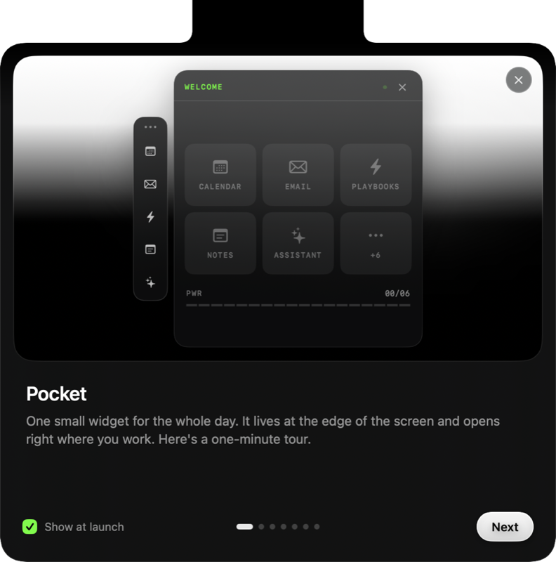
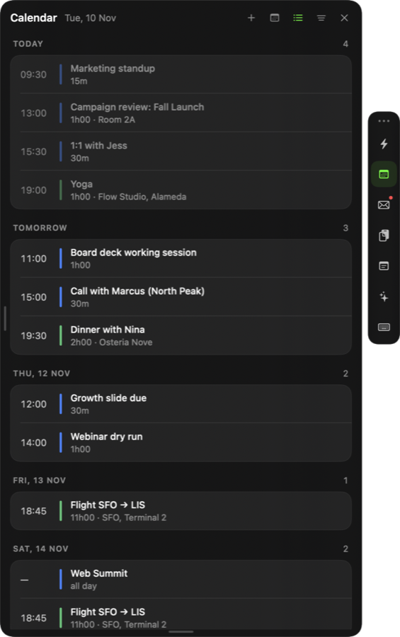
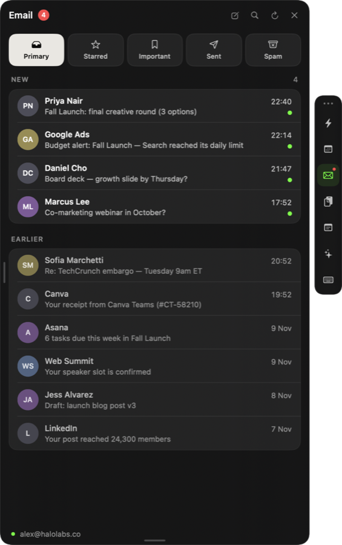
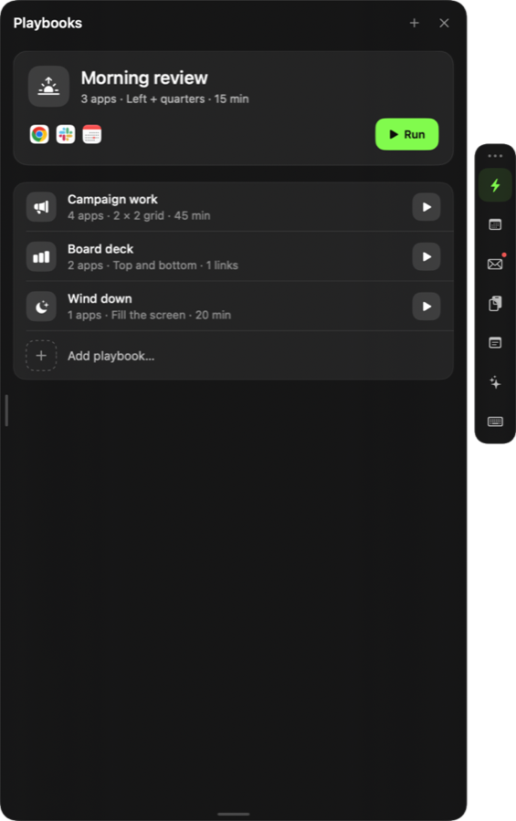
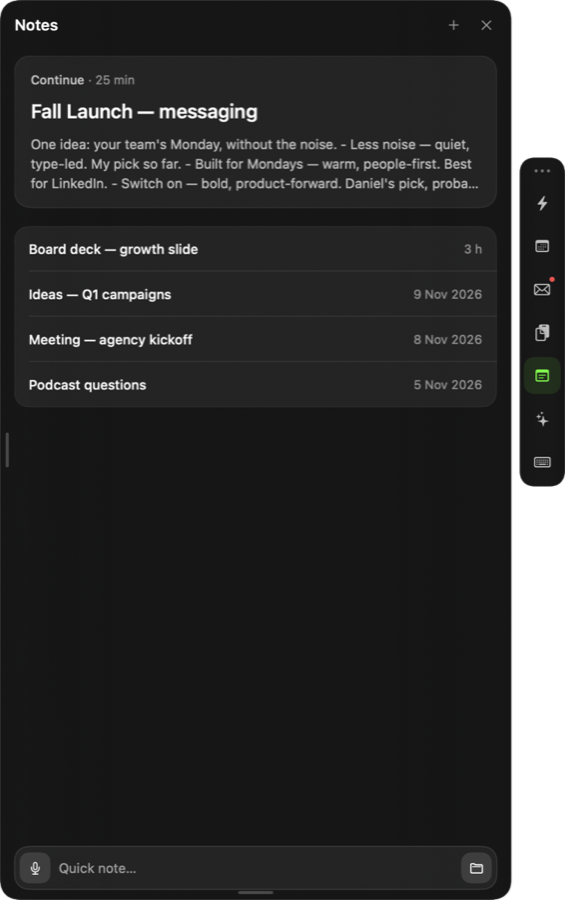
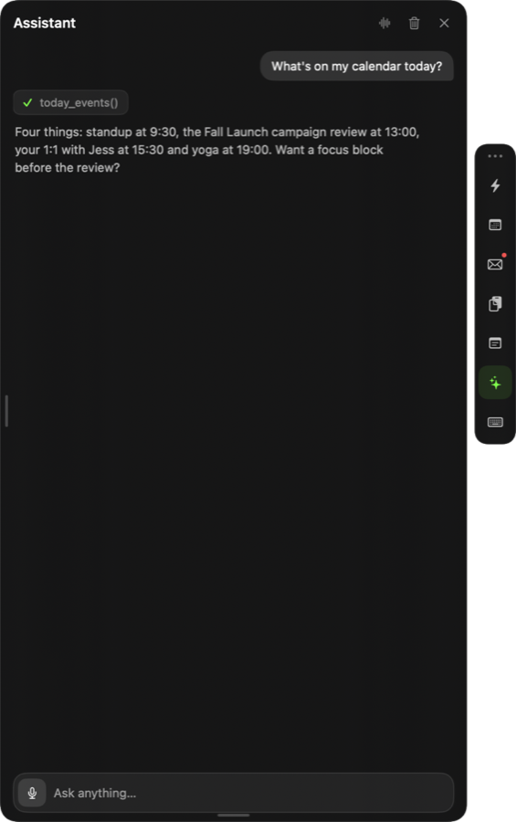
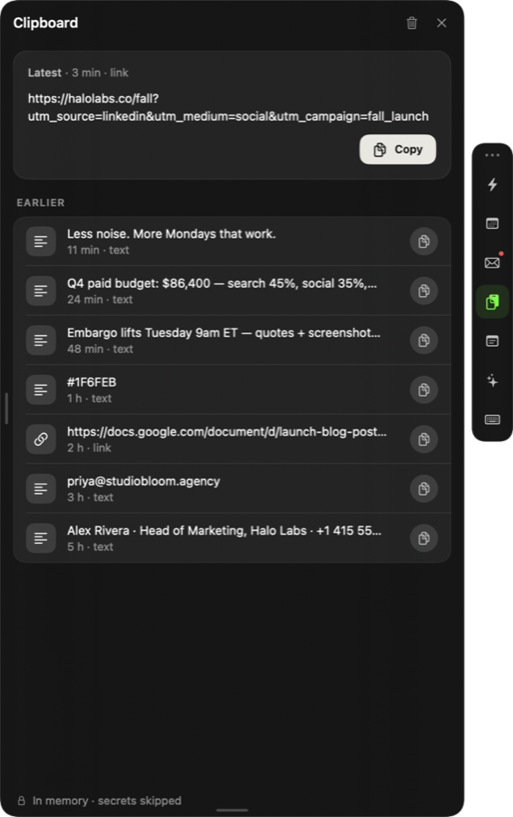

# Pocket

One small widget for the whole day. Pocket lives at the edge of your Mac's
screen and opens right where you work.

<p align="center">
  
</p>

<p align="center">
  
  
  
</p>
<p align="center">
  
  
  
</p>

<sub>Screenshots use demo data (`--demo`).</sub>

## Requirements

- macOS 14 or later
- Xcode 26+ (Swift 6)
- [XcodeGen](https://github.com/yonaskolb/XcodeGen): `brew install xcodegen`

The Xcode project is generated from `project.yml` and is not committed.

## Build and run

```sh
./run.sh -b            # generate the project, build Debug, launch
./run.sh -t -n         # build and run the unit tests, don't launch
./run.sh -b -d         # launch with demo data in every module
./run.sh -c -r         # clean Release build, then launch
./run.sh --help        # all options
```

Launch arguments, handy for screenshots and recordings:

| Argument | Effect |
| --- | --- |
| `--demo` | sample data in every module, nothing real is touched |
| `--tab <module>` | open a module's panel at launch (`calendar`, `email`, `notes`, …) |
| `--settings` | open settings at launch |
| `--onboarding` | show the welcome tour again |

```sh
open build/Build/Products/Debug/Pocket.app --args --demo --tab email
```

### Signing

Builds are ad-hoc signed by default, so any clone builds without a
certificate. To stop Keychain from re-prompting after every build, create a
gitignored `Support/Signing.local.xcconfig` with a stable identity — see
`Support/Signing.xcconfig`.

## Project layout

| Path | What lives there |
| --- | --- |
| `Sources/App` | app entry point and `AppDelegate` |
| `Sources/Core` | widget and capsule windows, view models, theme, localization, demo mode |
| `Sources/Modules` | one folder per module (Calendar, Email, Notes, Assistant, …) |
| `Sources/Services` | system integrations: hotkeys, keychain, speech, power, audio, windows |
| `Sources/Onboarding` | the welcome tour |
| `Sources/Settings` | settings screens |
| `Tests` | logic-only unit tests (mail parsing, assistant clients, geometry) |

## CI and releases

All checks run on GitHub-hosted runners (`.github/workflows`):

- **CI** — on pull requests to `develop`/`master` and pushes to `develop`:
  SwiftLint, actionlint, gitleaks (secrets), semgrep (security), clean build
  and unit tests.
- **Release** — on every push to `master`: reruns CI, builds Release and
  publishes `v<MARKETING_VERSION>` with a DMG, ZIP and SHA-256 checksums.
  If the tag already exists the release is skipped — bump
  `MARKETING_VERSION` in `project.yml` to ship a new version.

Branches: `feat/<name>` / `debug/<name>` → `develop` → `master`.

## License

Proprietary. © 2026 Danila Kozlov. All rights reserved.
